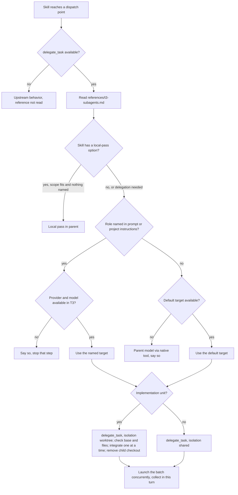

# T3 Code Layer and Orca Retirement - Plan

## Goal Capsule

- **Objective:** Compound Engineering runs in T3 Code put review and implementation subagents on the intended provider and model, launch them concurrently, and integrate worktree children safely, while the fork stays close enough to upstream that a sync is a plain merge.
- **Means:** delete the Orca overlay, add one shared T3 reference read at the dispatch point of the four skills that dispatch review or implementation subagents, and keep only three marked fork seams under a guard test (KTD1, KTD2, KTD9).
- **Authority:** the user's decisions recorded in the KTDs below, then this plan, then the project's `AGENTS.md`. Upstream owns all skill content outside the marked fork seams.
- **Execution profile:** one PR to `main`. The branch for this work is created on top of `chore/sync-upstream-3.33.2`, which holds 463 unpublished commits (upstream sync to 3.36.1), so that PR carries the sync unless the sync merges first (see Open Questions).
- **Stop conditions:** stop and report if a T3 eval shows a skill skipping `delegate_task` for a provider the user named, if removal leaves any skill reading a deleted file, or if `release:validate` cannot accept the first `-t3` pin.
- **Finish and ship:** `ce-work` implements and verifies; the T3 behavioral eval runs before the PR is opened; plugin reinstall on each host happens after the release ships.

---

## Product Contract

### Summary

Remove the Orca execution overlay from the fork and replace it with a thin T3 Code layer: one reference file, copied into four skills, that tells the agent which provider and model each kind of subagent uses in T3, how to launch and collect them, and how `ce-work` integrates worktree children. Proportional delegation stays as a fork-owned placement policy. Release identity moves to `<upstream>-t3.<N>`.

### Problem Frame

The user now works almost only in T3 Code. The fork still carries the Orca overlay: 193 files and about 39,000 lines of difference from upstream, reconciled at every upstream sync, for a tool the user no longer runs. An eval run in T3 on 2026-11-07 showed that unmodified upstream skills already route subagents to another provider through T3's `delegate_task` tool, with a Claude parent and with a Codex parent. The same eval showed three inconsistencies: a Codex parent launched its reviewers one after another, the two parents disagreed on whether "reviewers" covered the merge, validation and report steps, and `ce-work`'s cross-model engine wanted to create worktrees in the shell, which T3's rules forbid. The fork should remove what no longer serves the user and fix what the eval showed, at the smallest maintenance cost.

### Requirements

**Orca removal**

- R1. No Orca runtime, routing reference, generated bundle, `ce-orca-hook` marker, `orca:*` script, Orca test, `.ce-orca.json` schema or fixture, or `-orca.N` identity remains in the repository. Upstream's own mentions of Orca as a host (for example in `skills/ce-work/references/multi-pr-delivery.md`) stay.
- R2. Every file under `skills/` equals upstream at the recorded baseline commit once the marked fork seams are removed from it, and every file outside those seams' files equals upstream byte for byte.
- R3. Cross-model CLI peers use upstream's defaults: the Codex review peer at reasoning `high`, and the `ce-work` Codex route with model `auto`.

**T3 layer**

- R4. When T3 Code's `delegate_task` tool is available, including when the host lists it only as a deferred tool, `ce-code-review`, `ce-doc-review`, `ce-simplify-code` and `ce-work` read the shared T3 reference before dispatching review or implementation subagents. On any other host the reference is never read and behavior equals upstream.
- R5. A provider, model or reasoning level named for a subagent role in the prompt or in the project's instructions overrides the defaults. Fields the request leaves out take that model's own defaults as T3 reports them, not the values of the default block.
- R6. When nothing names them, review personas (code review, document review, simplification reviewers, adversarial) run on Codex `gpt-6.1-sol` with reasoning `xhigh`, implementation units on Codex `gpt-6.1-sol` with reasoning `medium` each in its own T3 worktree, and every other subagent on the parent's model through the native subagent tool.
- R7. A role covers only the subagents a skill dispatches for that role: "reviewers" means the persona reviewers, not merge, validation or report steps.
- R8. Independent subagents of one batch run concurrently. In T3 they are launched async and collected from T3's completion wake-ups, which `ce-code-review` accepts as host-delivered terminal outcomes.
- R9. When an explicitly requested provider or model is unavailable, the agent says so and stops that step. When a default is unavailable, the agent runs that step on the parent's model through the native tool and says so.
- R10. Reviewers run against the parent checkout, so uncommitted edits under review are visible to them.
- R11. In T3, `ce-work` serves implementation units on a provider T3 can run through `delegate_task` with worktree isolation instead of its cross-model engine. Before integrating a child, the agent confirms that the child's delta starts from the expected base and touches only the unit's predicted files, integrates units one at a time with each unit's verification, and then removes the child's checkout. A delta outside that scope is not integrated without the user.

**Proportional delegation**

- R12. `ce-simplify-code` and `ce-compound` keep choosing between a local pass and delegated subagents by whether the scope fits the parent's context. A provider, model or reasoning level named for those subagents forces delegation. The T3 defaults apply only to subagents actually dispatched.

**Release and maintenance**

- R13. Fork releases are versioned `<upstream>-t3.<N>` through a `release-as` pin. `release:validate` accepts a pin ahead of the released manifest and rejects a stale one. The first fork release is `3.36.1-t3.1`.
- R14. An upstream merge that drops a fork seam, changes upstream content inside a seamed file outside the seam, desynchronizes the copies of the T3 reference, or reintroduces Orca content makes `bun run test` fail.
- R15. `bun run codex:dev -- local` works again in this checkout.
- R16. The fork's docs describe the T3 layer, the remaining seams and the sync procedure, and no doc points to a deleted Orca file.

### Key Decisions

- **The fork drops Orca rather than slimming it.** The user works in T3 Code and the overlay's sync cost buys nothing. Governs R1, R2. (session-settled: user-directed — chosen over lightening the overlay: Orca is no longer used and partial removal keeps most of the fixed cost)
- **T3 support is routing guidance, not an execution adapter.** The eval showed upstream skills already delegate correctly through `delegate_task`. Governs R4, R5, R6, R7, R8, R9. (session-settled: user-directed — chosen over a T3 adapter mirroring Orca's runtime: the adapter would rebuild a workflow engine for weaker guarantees)
- **Cross-model CLI peers return to upstream defaults.** Governs R3. (session-settled: user-approved — chosen over keeping the fork's `xhigh` and `gpt-6.1-sol` seams: the T3 reference covers subagents, and each seam is one more conflict per sync)
- **Default models are Codex `gpt-6.1-sol` at `xhigh` for reviewers and `medium` for implementation, parent model for the rest.** Governs R6. (session-settled: user-approved — chosen over defaulting reviewers to whichever provider the parent is not: the values match what the user ran under Orca)
- **Proportional delegation stays, with placement decided before defaults.** Governs R12. (session-settled: user-approved — chosen over dropping it to match upstream: without it a ten-line change would launch six Codex `xhigh` reviewers)

### Scope Boundaries

- Behavior outside T3 Code is not changed. Skills read the T3 reference only when `delegate_task` is available.
- No upstream contribution. The `ce-work` rule and the T3 reference stay in the fork (session-settled: user-directed — chosen over proposing the `ce-work` fix upstream: the user wants the change in the fork).
- `lfg` gets no copy of the T3 reference: it dispatches no review or implementation subagents itself, and the skills it runs carry their own copy.
- The GitHub repository keeps the name `compound-engineering-orca`, and manifests keep pointing to it.
- `docs/reports/2026-09-05-proportional-delegation-validation.md` and `docs/reports/2026-09-16-upstream-3.26.3-sync.md` stay as dated history.
- The CI bun pin (`bun-version: 1.3.14`) stays: it addresses a bun hang unrelated to Orca.
- Considered and not built: a plugin `SessionStart` hook. Codex runs a plugin hook only after the user approves it in Codex's terminal UI, approval resets on every plugin update because the fingerprint covers the whole plugin root, T3 does not expose `T3CODE_THREAD_ID` to Codex hooks, a root `hooks/hooks.json` makes `bun run codex:dev -- local` refuse to run (`src/dev/codex-dev.ts:139-155`), and the converter would copy the hook into five targets. Evidence that Codex trusts plugin hooks without per-update approval and exposes the thread variable would reopen it.
- Considered and not built: a deterministic validator for the model names in the T3 reference. `delegate_task` rejects an unknown provider or model itself, and R9 defines the response.

#### Deferred to Follow-Up Work

- Remove the stray committed file `.xmodel-cr-test-dirty` and the duplicated `#1346` describe block in `tests/ce-babysit-pr-snapshot.test.ts:5348-5382`.
- Capture a learning with `ce-compound` once this lands: no learning covers Orca removal, Codex plugin hook trust, or the fork-seam guard.

---

## Planning Contract

### Key Technical Decisions

- KTD1. **Remove Orca atomically across every skill in one change.** Upstream once removed a shared mechanism from one skill's prose only and had to revert (#1311 -> #1313, `docs/solutions/skill-design/harness-agent-gate-workaround.md`). Every payload riding an Orca seam is either deleted or moved to the boundary that still consumes it (U1, U3). Governs R1, R2. (session-settled: user-directed — chosen over lightening the overlay: Orca is no longer used)
- KTD2. **The T3 reference is a skill-local file, `references/t3-subagents.md`, in four skills, read through a one-line pointer at each dispatch point.** The pointer is the condition "when T3 Code's `delegate_task` tool is available, including as a deferred tool". Detecting the tool works on Claude and Codex parents alike, where an environment variable does not reach Codex hooks. Governs R4. (session-settled: user-directed — chosen over a plugin `SessionStart` hook: Codex hook trust resets on every update and the hook breaks `codex:dev` and leaks into converter output)
- KTD3. **`skills/ce-code-review/references/t3-subagents.md` is the canonical copy.** The other three are byte-identical and a test enforces it, following the `peer-job-runner.py` parity pattern (`tests/peer-job-runner-parity.test.ts`, `docs/solutions/workflow/reviewing-byte-duplicated-shared-assets.md`). Edits land in the canonical copy and are propagated.
- KTD4. **In T3, `ce-work`'s rule acts at engine selection, before the cross-model engine is chosen.** The cross-model engine provisions its own worktrees through `unit-workspace.py` and records receipts against them, so it cannot adopt a host checkout. The pointer therefore sits in `skills/ce-work/references/execution-engines.md`, which `ce-work` reads before every run (`skills/ce-work/SKILL.md:38`), directly under the heading "Decide whether an external route applies" and before its first paragraph, so it is read before any route source is weighed. The Orca block's old position, after standing configuration, is too late. A provider T3 can run is served by native dispatch with `delegate_task` worktree isolation, which upstream already allows ("Isolation for native workers is the harness's job", `skills/ce-work/references/execution-strategy.md:28-31`). A run already started on the cross-model engine recovers under that engine. A standing `work_engine_mode` preference for a T3-runnable provider is served the same way as a live request. Governs R11. (session-settled: user-directed — chosen over an upstream contribution: the user wants the fix in the fork. The mechanism refines the wording approved in conversation, which named `unit-workspace.py` as the thing to replace)
- KTD5. **Collection is concurrent: launch async, collect on T3's wake-up.** The 2026-11-07 eval showed Codex parents running `mode: "wait"` delegations one after another even when issued together (each child started about 200 ms after the previous one finished), and T3's async result instructs the parent to end its turn and be woken rather than wait on or poll the child. The reference therefore launches every subagent of a batch with `mode: "async"`, ends the turn as T3 instructs, and collects each completion, which arrives as a host-delivered terminal message naming the launch. `mode: "wait"` is kept for a single subagent whose result the next step needs. A re-run confirmed concurrent children under both a Claude and a Codex parent. Governs R8.
- KTD6. **Defaults never stop a run.** R9 separates an explicit request from a default because T3's own rule against unasked substitution concerns choices the user made. A lapsed Codex login must not end an `lfg` run the user never pointed at Codex. Governs R9.
- KTD7. **Reasoning level is named with the provider's own option.** T3 names it `reasoningEffort` for Codex, `effort` for Claude and `reasoning` for Cursor (`orchestrator_capabilities`). The reference says to read the option name from `orchestrator_capabilities` rather than listing them. An omitted level runs `gpt-6.1-sol` at its T3 default, `low`. Governs R5, R6.
- KTD14. **Children inherit the parent's runtime mode and approval posture.** The reference never sets `runtimeMode` on `delegate_task`. T3's narrower modes pause for human approval rather than restricting tools, so a reviewer would stall instead of being made read-only. Read-only reviewers stay read-only through their persona prompt, as upstream does. Governs R10.
- KTD8. **Placement policy becomes `references/placement.md` in `ce-simplify-code` and `ce-compound`, rewritten without Orca.** It keeps the current policies' substance (`integrations/orca/references/simplify-delegation.md`, `compound-delegation.md`) and drops every reference to `.ce-orca.json`, `orca-routing.md` and Orca packets. A provider, model or reasoning level named for those subagents in the prompt or the project's instructions counts as an assignment and forces delegation. The T3 defaults are not assignments. In `ce-simplify-code` the delegated path points to `references/t3-subagents.md` under KTD2's condition. Governs R12. (session-settled: user-approved — chosen over dropping proportional delegation to match upstream: small scopes would launch six `xhigh` reviewers)
- KTD9. **Fork seams use `ce-fork-hook:start <id>` / `ce-fork-hook:end <id>` markers, the same length as `ce-orca-hook`.** `skills/ce-simplify-code/SKILL.md` has 5 bytes left under the Codex prompt budget (`tests/codex-skill-prompt-budget.test.ts`). Its replacement block must not grow: keep a four-character id and the shorter target name `references/placement.md`. The remaining seams are:
  1. the placement pointer in `skills/ce-simplify-code/SKILL.md`;
  2. the placement pointer in `skills/ce-compound/references/research.md`;
  3. the T3 pointers in `skills/ce-code-review/references/dispatch-reviewers.md`, `skills/ce-doc-review/references/dispatch.md` and `skills/ce-work/references/execution-engines.md`.

  Fork-only files (`placement.md`, `t3-subagents.md`) carry no markers. Governs R2, R14.
- KTD10. **The guard pins the upstream baseline as a constant in its own test file and reads it from a fetched upstream.** A new `tests/fork-seams.test.ts` holds `UPSTREAM_BASELINE` (today `2921168fc84b4070308a9ef6d115063cf62198cf`) and compares stripped files with `git show <baseline>:<path>`. The sync procedure updates that constant. Upstream commits are not ancestors of `main` today: earlier sync PRs were squash-merged (`47b479f3` has one parent, and upstream `173bd337` is not reachable from `origin/main`). The CI step that fetches upstream (`.github/workflows/ci.yml:107-112`) therefore stays, without `--tags`, now that the Orca tag-currency check is gone. When the baseline object is missing locally, the test fails with a message naming `UPSTREAM_BASELINE` and `git fetch upstream main`. Governs R14.
- KTD15. **Sync PRs, including this one while it carries the 3.36.1 sync, land as merge commits.** A squash merge drops upstream's history from `main`, so the next `git merge upstream/main` has no recent merge base and re-conflicts on every file the fork touched. That defeats the Objective's "a sync is a plain merge". GitHub allows merge commits on this repository. Governs R14.
- KTD11. **The release comparator learns `-t3.N` and forgets `-orca.N`.** No `-orca` release ever shipped: `origin/main`'s manifest is `3.24.0` and the fork has no GitHub release. `compareReleaseVersions` in `src/release/config.ts:20-44` replaces its `-orca` pattern with `-t3` and keeps ordering fork revisions above their upstream base for this repository's check. Every fork release pins `release-as`, because an ordinary release-please bump keeps the suffix and could claim an upstream base that does not exist (for example `3.36.2-t3.1`). The pin is removed once its release ships, as today. Governs R13. (session-settled: user-approved — chosen over keeping `-orca.N`: the name should match what the fork is now)
- KTD12. **`package.json` returns to upstream's `name` (`compound-engineering`) and description.** `src/dev/codex-dev.ts:126` requires that name, so the fork's rename broke `bun run codex:dev`. Repository, homepage and marketplace URLs keep pointing to the fork. Governs R15.
- KTD13. **The domain-vocabulary residue returns to upstream.** It sits in `skills/ce-compound/references/grounding-validation.md:43-45` (inside `ce-orca-hook` markers) and in four `learnings-researcher.md` personas (`ce-code-review`, `ce-ideate`, `ce-optimize`, `ce-plan`). The skills that produced its `## Contexts` index and `DOMAIN.md` stamps were deleted in the 3.24.0 sync, so nothing reads or writes that format any more. Governs R2.

### High-Level Technical Design

How a dispatching skill resolves each subagent's target in T3. The prose in R5 to R11 and KTD4 to KTD7 governs; the diagram shows the order of the gates.

### Assumptions

- T3's `delegate_task`, `orchestrator_capabilities` and worktree isolation keep their current shape for the life of this change. T3 ships as a nightly build (`t3 v0.1.8-nightly.20261107.4301`).
- No T3 tool removes a child worktree today. The reference gives `git worktree remove` on the child's path, unless implementation shows T3 cleans up after the task itself.

---

## Implementation Units

### U1. Remove the Orca overlay

**Goal:** every Orca file, seam, script and test is gone in one change, and every Orca-dispatch seam is back to upstream content.

**Requirements:** R1, R2 (KTD1, KTD13).

**Dependencies:** none.

**Files:**
- Delete: `integrations/orca/` (whole directory).
- Delete: the generated bundles under `skills/{ce-code-review,ce-compound,ce-debug,ce-doc-review,ce-plan,ce-simplify-code,ce-work,lfg}/`: `references/orca-defaults.json`, `references/orca-execution-request.schema.json`, `references/orca-result.schema.json`, `references/orca-role-registry.json`, `references/orca-routing.md`, `scripts/orca-runtime.mjs`, `scripts/orca-workflow.mjs`, `scripts/orca-workflow-registry.json`, `scripts/result-contract.mjs`.
- Delete: the hand-written Orca references `skills/ce-code-review/references/orca-review-dispatch.md`, `skills/ce-compound/references/orca-read-analysis.md`, `skills/ce-debug/references/orca-investigation.md`, `skills/ce-doc-review/references/orca-dispatch.md`, `skills/ce-plan/references/orca-read-analysis.md`, `skills/ce-simplify-code/references/orca-review-dispatch.md`, `skills/ce-work/references/orca-execution.md`, `skills/lfg/references/orca-lfg.md`.
- Delete: `tests/orca-*.test.ts` (13 files) and `tests/skill-eval-cell/fixtures/proportional-delegation-configured/`.
- Revert to upstream: `skills/ce-code-review/references/finish-input.md`, `skills/ce-compound/references/assembly.md`, `skills/ce-compound/references/grounding-validation.md`, `skills/ce-debug/references/investigate.md`, `skills/ce-plan/references/research.md`, `skills/lfg/references/task-visibility.md`, the four `learnings-researcher.md` personas named in KTD13, `tests/skills/ce-plan-handoff-routing.test.ts`.
- Remove the Orca block, leaving upstream content: `skills/ce-code-review/references/dispatch-reviewers.md`, `skills/ce-doc-review/references/dispatch.md`, `skills/ce-work/references/execution-engines.md`. U4 adds the T3 pointers at the anchors it names.
- Modify: `package.json` (drop the `orca:*` scripts), `tsconfig.json` (drop `integrations/orca/**/*.d.ts`), `.github/workflows/ci.yml` (the upstream fetch step drops `--tags`, KTD10).

**Approach:**
1. Delete the directory, the bundles, the hand-written references and the tests.
2. Revert each listed upstream file with its content at `2921168f`, then diff each against upstream to confirm only intended differences remain.
3. Leave `skills/ce-simplify-code/SKILL.md` and `skills/ce-compound/references/research.md` for U3, and the cross-model seams for U2.
4. Search `skills/`, `tests/`, `src/`, `scripts/` and `docs/guides/` for `orca-routing`, `orca-delegation`, `.ce-orca.json`, `integrations/orca` and `ce-orca-hook`, and resolve each hit in its owning unit.

**Patterns to follow:** the atomic-removal rule in `docs/solutions/skill-design/harness-agent-gate-workaround.md`.

**Test scenarios:**
- `bun run test:skill-guards` passes with no skill referencing a missing file.
- `git diff 2921168f -- skills/ce-debug skills/ce-plan skills/lfg` is empty.
- `tests/codex-skill-prompt-budget.test.ts` still passes for every reverted SKILL.md.

**Verification:** no file under `skills/`, `tests/` or `src/` names a deleted Orca path, and the reverted files match upstream byte for byte.

### U2. Return cross-model peer defaults to upstream

**Goal:** the Codex review peer and the `ce-work` Codex route behave exactly as upstream's.

**Requirements:** R3 (Key Decision: cross-model CLI peers return to upstream defaults).

**Dependencies:** none.

**Files:**
- Revert to upstream: `skills/ce-code-review/references/cross-model-review.md`, `skills/ce-code-review/scripts/cross-model-adversarial-review.sh`, `skills/ce-doc-review/references/cross-model-review.md`, `skills/ce-doc-review/scripts/cross-model-doc-review.sh`, `skills/ce-work/references/cross-model-execution.md`, `skills/ce-work/scripts/cross-model-work.sh`, `skills/ce-work/scripts/unit_workspace_state.py`, `skills/ce-setup/references/config-template.yaml`, `.compound-engineering/config.example.yaml`.
- Revert tests: `tests/skills/ce-code-review-cross-model-routes.test.ts`, `tests/skills/ce-doc-review-cross-model-routes.test.ts`, `tests/skills/ce-work-cross-model-routes.test.ts`, `tests/skills/ce-work-cross-model-integration.test.ts`, `tests/skills/ce-work-unit-workspace-init.test.ts`, `tests/skills/helpers/ce-work-workspace-harness.ts`.
- Revert docs: `docs/guides/ce-code-review.md`, `docs/guides/ce-doc-review.md`, `docs/guides/ce-work.md`, `docs/guides/configuration.md` (only the Codex default lines).

**Approach:** restore each file from `2921168f`. The template and its `.compound-engineering/config.example.yaml` copy stay byte-identical. The model-identity receipt fields (`model_requested`, `model_actual`, `independence_verified`) come back unchanged with the upstream scripts (`docs/solutions/skill-design/requested-vs-verified-model-identity.md`).

**Test scenarios:**
- A cross-model code review with no model selector requests Codex `gpt-6.1-sol` at `reasoning_effort=high`.
- A `ce-work` Codex route with no model selector passes no `--model` and records `auto`.
- The config template and `config.example.yaml` are byte-identical.

**Verification:** each listed file equals upstream, and the `ce-work-unit-workspace-*` test shards pass.

### U3. Keep proportional delegation as a fork-owned placement policy

**Goal:** `ce-simplify-code` and `ce-compound` keep their local-pass option with no Orca dependency.

**Requirements:** R12 (KTD8, KTD9).

**Dependencies:** U1.

**Files:**
- Create: `skills/ce-simplify-code/references/placement.md`, `skills/ce-compound/references/placement.md`.
- Delete: `skills/ce-simplify-code/references/orca-delegation.md`, `skills/ce-compound/references/orca-delegation.md`.
- Modify: `skills/ce-simplify-code/SKILL.md` (seam block), `skills/ce-compound/references/research.md` (seam block keeps only the placement pointer).
- Modify: `tests/skill-eval-cell/proportional-delegation.ts`, `tests/skill-eval-cell/catalog.ts`, `tests/skill-eval-cell/catalog.test.ts`.

**Approach:**
1. Derive each `placement.md` from its current policy. Remove the Orca configuration and routing paragraphs, and state the assignment rule and the T3 pointer from KTD8.
2. Replace each Orca block with a `ce-fork-hook` block pointing to `references/placement.md`. In `SKILL.md` the block must not exceed the current one's bytes.
3. In the eval catalog, point the five Orca-free scenarios at `references/placement.md` and delete `configured-research-route`, which only existed to test `.ce-orca.json`.

**Patterns to follow:** the current policy files under `integrations/orca/references/` for substance. `docs/solutions/skill-design/portable-agent-skill-authoring.md` (the "required coverage and execution placement are separate contracts" paragraph) for the standard.

**Test scenarios:**
- `skills/ce-simplify-code/SKILL.md` stays within 8,000 bytes under `tests/codex-skill-prompt-budget.test.ts`.
- `tests/skill-eval-cell/catalog.test.ts` lists `references/placement.md` as an expected skill file for both skills.
- Neither `placement.md` contains `orca`, `.ce-orca.json` or `orca-routing`.

**Verification:** the five remaining proportional-delegation scenarios pass on Claude and Codex with the current tree, and a small scope still produces a local pass.

**Execution note:** this is skill prose. Invoke the repo-local `ce-skill-work` skill before editing.

### U4. Add the shared T3 reference and its pointers

**Goal:** in T3, the four dispatching skills resolve subagent targets, launch, collect and integrate as R4 to R11 state.

**Requirements:** R4, R5, R6, R7, R8, R9, R10, R11 (KTD2, KTD3, KTD4, KTD5, KTD6, KTD7).

**Dependencies:** U1, U3.

**Files:**
- Create: `skills/ce-code-review/references/t3-subagents.md` (canonical), with byte-identical copies `skills/ce-doc-review/references/t3-subagents.md`, `skills/ce-simplify-code/references/t3-subagents.md`, `skills/ce-work/references/t3-subagents.md`.
- Modify, each with one `ce-fork-hook` pointer:
  - `skills/ce-code-review/references/dispatch-reviewers.md` and `skills/ce-doc-review/references/dispatch.md`: at the top of the file, where the Orca block sat.
  - `skills/ce-work/references/execution-engines.md`: at the anchor KTD4 names.

  `ce-simplify-code` reaches the reference through `placement.md` (U3).

**Approach:**
1. Write the reference as conditions, not procedures: precedence and partial requests (R5), defaults and role scope (R6, R7), concurrency and in-turn collection (R8, KTD5), unavailability (R9, KTD6), isolation per role (R10), and the `ce-work` worktree rule (R11, KTD4). Name the reasoning option source (KTD7) and the worktree removal command.
2. Word each pointer as KTD2's condition, so a host without `delegate_task` never reads the file.
3. In `execution-engines.md`, the pointer's position (KTD4) means a T3-runnable provider never enters the cross-model engine.

**Patterns to follow:** the stance of `docs/solutions/skill-design/portable-agent-skill-authoring.md` (state conditions, the safe failure direction, and non-derivable facts). The pointer shape of the existing `ce-orca-hook` blocks.

**Test scenarios:**
- The four copies of `t3-subagents.md` are byte-identical (enforced in U6).
- Each pointer names `delegate_task` and `references/t3-subagents.md`, and lies inside a `ce-fork-hook` block.
- `skills/ce-work/SKILL.md` is unchanged and stays within budget.

**Verification:** the T3 behavioral eval in the Verification Contract passes on a Claude parent and a Codex parent.

**Execution note:** this is skill prose. Invoke the repo-local `ce-skill-work` skill before editing, and evaluate by injecting the on-disk skills into fresh T3 threads, never through the installed plugin.

### U5. Move the release identity to `-t3.N`

**Goal:** the first fork release can ship as `3.36.1-t3.1` and later fork releases order correctly.

**Requirements:** R13, R15 (KTD11, KTD12).

**Dependencies:** U1.

**Files:**
- Modify: `src/release/config.ts`, `.github/release-please-config.json` (`release-as` becomes `3.36.1-t3.1`), `package.json` (name and description), `tests/release-config.test.ts`, `tests/omp-native-install.test.ts`.

**Approach:**
1. Replace the `-orca` pattern and its comment in `compareReleaseVersions` with `-t3`.
2. Rewrite the tests that read `integrations/orca/version.mjs`. The pin test asserts that a present pin has the form `<x.y.z>-t3.<n>` and is ahead of the base-branch manifest.
3. Restore upstream's `name` and description in `package.json`, and the upstream expectation in `tests/omp-native-install.test.ts`.

**Test scenarios:**
- `3.36.1-t3.2` orders after `3.36.1-t3.1`, and `3.36.1-t3.1` orders after `3.36.1`.
- A pin `3.36.1-t3.1` against a released `3.24.0` passes `validateReleasePleaseConfig`.
- A pin equal to the released version is reported stale.
- A `-orca.7` pin is no longer treated as a fork revision.
- `bun run codex:dev -- status` runs without the package-name error.

**Verification:** `bun run release:validate` passes with the new pin, and `bun run codex:dev -- local` links the worktree's skills.

### U6. Guard the remaining fork seams

**Goal:** an upstream merge cannot silently drop a seam, alter upstream text around it, desynchronize the T3 copies or bring Orca back.

**Requirements:** R2, R14 (KTD9, KTD10).

**Dependencies:** U3, U4.

**Files:**
- Create: `tests/fork-seams.test.ts`.

**Approach:**
1. Keep one table of `{file, id}` for the three seams in KTD9, and assert exactly one start and one end marker per entry.
2. For each seamed file, strip the marked block and compare the rest with `git show <UPSTREAM_BASELINE>:<file>`.
3. Assert that every pointer target exists, and that the four `t3-subagents.md` copies equal the canonical one.
4. Assert that no file under `skills/` matches `ce-orca-hook`, `orca-routing`, `orca-delegation`, `.ce-orca.json` or a path starting with `orca-`, and that `integrations/orca` does not exist. Plain mentions of Orca as a host are not matched.

**Patterns to follow:** the marker-count and strip-and-compare checks in `tests/orca-native-parity.test.ts:76-147` and `:594-616` (deleted in U1; read them from history), the `split(marker).length === 2` idiom.

**Test scenarios:**
- Removing the placement block from `skills/ce-simplify-code/SKILL.md` fails the marker check.
- Editing one word of upstream text in `skills/ce-code-review/references/dispatch-reviewers.md` outside the seam fails the strip-and-compare check.
- Changing one byte in `skills/ce-work/references/t3-subagents.md` fails the copy check.
- Adding `skills/ce-plan/references/orca-routing.md` fails the reintroduction check.
- A checkout without the `UPSTREAM_BASELINE` object fails with a message naming the constant and `git fetch upstream main`.

**Verification:** the test passes on the finished tree and fails on each mutation above.

### U7. Update the fork's documentation

**Goal:** a contributor can learn the fork's seams, the T3 layer and the sync procedure from the docs alone.

**Requirements:** R16.

**Dependencies:** U1, U3, U4, U5, U6.

**Files:**
- Modify: `AGENTS.md` (replace "Orca Fork Overlay" with a fork section), `README.md`, `docs/guides/ce-simplify-code.md`, `docs/guides/ce-compound.md`.

**Approach:**
1. In `AGENTS.md`, state the three seams and the two fork-only reference files. Give the sync procedure: merge `upstream/main`, update `UPSTREAM_BASELINE`, run `tests/fork-seams.test.ts`, and land the sync PR as a merge commit (KTD15). Give the release identity and the pin-every-release rule (KTD11).
2. In `README.md`, replace the overlay pointer and the Cursor `orca.read-policy/v1` paragraph with a short T3 Code section. Keep the Codex plugin refresh commands.
3. In the two guides, replace "Orca execution placement" with the placement policy as it now works.

**Test expectation:** none -- documentation only, covered by `bun run release:validate` and `tests/release-metadata.test.ts` staying green.

**Verification:** no doc names a deleted path, and `AGENTS.md` describes every seam the guard test lists.

---

## Verification Contract

| Gate | Command or method | Applies to |
|---|---|---|
| Focused tests while iterating | `bun run test tests/fork-seams.test.ts tests/release-config.test.ts tests/codex-skill-prompt-budget.test.ts tests/skill-eval-cell/catalog.test.ts tests/peer-job-runner-parity.test.ts` and the `tests/skills/ce-work-*` shards | U1 to U6 |
| Skill guards | `bun run test:skill-guards` | after every skill edit |
| Publishing check | `bun run test --changed-since=<40-character base SHA>` on a clean committed candidate | before the PR |
| Types | `bun run typecheck` | before the PR |
| Release metadata | `bun run release:validate` | U5 and before the PR |
| Plugin schema | `bun run plugin:validate` | before the PR |
| Upstream parity by inspection | `git diff 2921168f -- skills/` shows only the three seams, `placement.md` twice and `t3-subagents.md` four times | before the PR |
| Non-T3 behavioral evals | `bun run test:skill-eval-pack -- --skill <name> --arm ab` for `ce-work` (`ce-work-cross-model.md`, including E1), `ce-code-review` and `ce-doc-review` cross-model packs, plus the proportional-delegation scenarios, on Claude and Codex. Expected result: no regression. | U2, U3 |
| T3 behavioral eval | see below | U4 |

**T3 behavioral eval.** This eval runs inside T3 Code threads, because `delegate_task` exists only there and `test:skill-eval-cell` runs outside T3.
- Use a throwaway fixture repo registered as a T3 project. Inject the on-disk skill directories from this branch by path, so the installed plugin's cached Orca-era copies are not read.
- Run each scenario with a Claude parent and with a Codex parent:
  1. `ce-code-review` with a named reviewer model.
  2. `ce-code-review` with no model named (defaults apply).
  3. `ce-doc-review` with defaults.
  4. `ce-simplify-code` on a small scope (local pass expected) and on a scope naming a model (delegation expected).
  5. `ce-work` on a two-unit plan with Codex workers.
  6. One scenario naming an unavailable provider.
- Grade from the thread activity:
  - targets and reasoning options on each `delegate_task` call;
  - concurrency and in-turn collection;
  - `isolation` per role;
  - for `ce-work`: no shell-created worktree, base and file checks before integration, and child checkouts removed;
  - stop or fallback wording on the unavailable-provider scenario.
- Report hosts run and results in the PR. Name any host that did not run, and why.

---

## Definition of Done

- R1 to R16 hold, and each unit's verification passes.
- Every gate in the Verification Contract passes, or its failure is reported with output.
- `git diff 2921168f -- skills/` contains only the fork seams and fork-only files named in KTD9.
- No abandoned-attempt code, stray fixture or commented-out Orca block remains in the diff.
- The PR body fills the Security Disclosure and Agent Disclosure sections and reports the eval hosts.

---

## System-Wide Impact

- **Other T3 providers.** T3 also runs Cursor, Grok, Pi and other parents. Any parent that sees `delegate_task` reads the same reference, so they get the same defaults and rules. No per-provider branch is needed.
- **Hosts outside T3.** Claude Code, Codex, Cursor, OMP, Pi, Antigravity and the other native installs receive four extra reference files that they never read, because the pointer's condition fails without `delegate_task`.
- **Converter and installers.** No hook, manifest field or new top-level directory is added. `src/` converters and `bun run codex:dev` see ordinary skill files only.
- **Upstream sync cost.** The fork diff to upstream shrinks from 193 files to the files named in KTD9, KTD11 and KTD12 plus the guard test and docs.

---

## Risks & Dependencies

- **Wake-up delivery is verified once per parent.** The async-and-wake mechanism (KTD5) ran correctly under a Claude parent and a Codex parent on 2026-11-07. A T3 change to how completions wake a parent would break collection; the T3 eval is the check.
- **Host updaters may order `3.36.1-t3.1` below `3.36.1`.** Standard SemVer puts a prerelease below its base, and installed copies report `3.36.1` today. If a host does not offer the update, reinstall the plugin from the fork marketplace (see Operational Notes).
- **T3 is a nightly build.** A change to `delegate_task`'s options or to how deferred tools are listed would change what the pointer's condition detects. The T3 eval is the check, and the reference names capabilities rather than option lists where it can.
- **Nested skills in evals read the installed copy.** A skill invoked by another skill loads from the plugin cache, so nested results reflect the installed version until the branch is installed. Grade only the injected top-level skill.

---

## Operational Notes

After the release ships, refresh the plugin on each host where the fork is installed.
- On Codex: `codex plugin marketplace upgrade compound-engineering-plugin`, then `codex plugin add compound-engineering@compound-engineering-plugin`.
- On Claude Code: update the marketplace and reinstall the plugin.

Start new sessions afterwards, because skills are cached at session start. Then remove the stale `release-as` pin before unrelated work, as `release:validate` requires.

---

## Open Questions

- Resolved during implementation: collection uses async launches and T3's wake-up for both parents (KTD5).
- Deferred to implementation: whether T3 removes a delegated child's worktree itself. The default is `git worktree remove` on the child's path.
- Merge gate: whether `chore/sync-upstream-3.33.2` is reviewed and merged as its own PR first, or rides in this PR. The default is one PR carrying both, merged with a merge commit (KTD15).

---

## Sources & Research

- 2026-11-07 T3 eval threads (Claude parent and Codex parent, `ce-code-review` and `ce-work`): observed `delegate_task` routing, sequential waits under a Codex parent, and the shell-worktree conflict.
- `src/dev/codex-dev.ts:126`, `:139-155` and `tests/codex-dev.test.ts:765-779`: the package-name check and the hook refusal.
- `src/release/config.ts:20-44`, `.github/release-please-config.json:100`, `tests/release-config.test.ts:87-156`: current fork version handling.
- `skills/ce-work/SKILL.md:38-42`, `skills/ce-work/references/execution-engines.md`, `skills/ce-work/references/execution-strategy.md:28-31`: where engine selection happens and who owns native isolation.
- `skills/ce-code-review/SKILL.md:32`: the in-turn reviewer collection contract.
- `docs/solutions/skill-design/harness-agent-gate-workaround.md`, `docs/solutions/skill-design/workspace-isolation-is-escalation-not-entry-fee.md`, `docs/solutions/workflow/reviewing-byte-duplicated-shared-assets.md`, `docs/solutions/developer-experience/codex-local-skill-development-workflow.md`, `docs/solutions/workflow/release-please-version-drift-recovery.md`.
- Codex hooks: https://learn.chatgpt.com/docs/hooks and `codex-rs/hooks/src/engine/plugin_fingerprint.rs`, `engine/plugin_trust.rs` in github.com/openai/codex (plugin hooks require review, and the fingerprint covers the plugin root).
